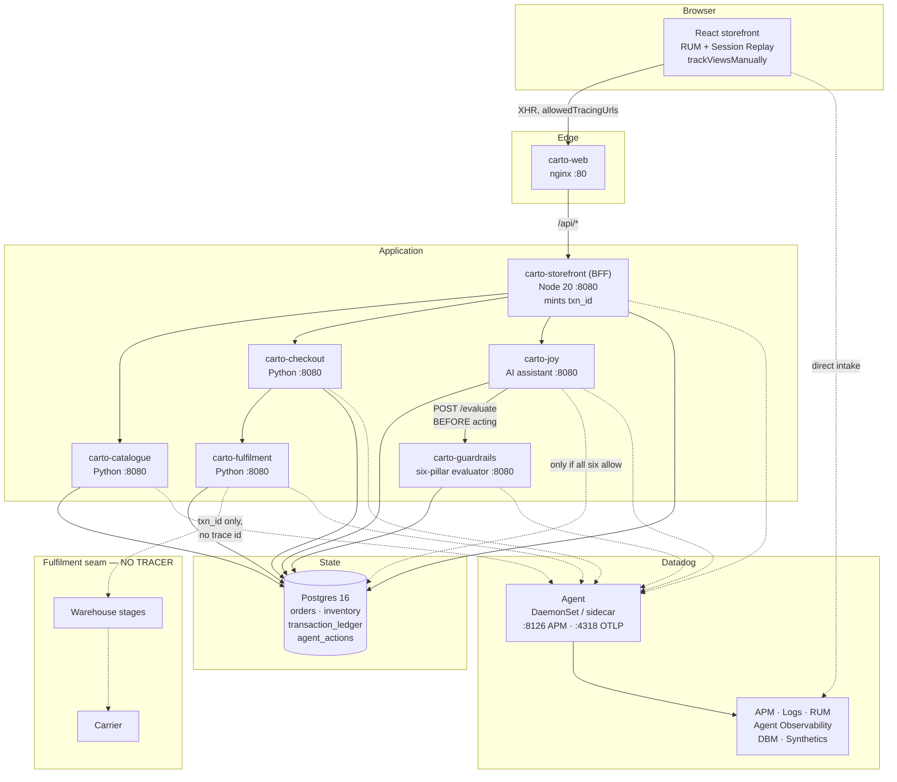

# Carto — a Datadog demo harness you can actually deploy

A working online retailer, instrumented end to end, built to tell one story in front of one room:
**a new range goes live, a customer finds it, adds to the bag and checks out on a peak trading
day** — and every rung of the observability maturity ladder is climbed against that single journey.
On top of that sits a second story: **an AI assistant that is allowed to act on a customer's order,
and the six guardrails that decide whether it may.**

> **Carto is fictional.** The brand, wordmark, palette, product range and shoppers were invented for
> this harness. No real customer, order or company data appears anywhere in this repository.

Two things make it more than a toy:

1. **Business tracking ids that survive where tracing stops.** Datadog stamps every request with a
   trace id, and inside the instrumented estate that is the best identifier there is. It stops being
   enough at the **fulfilment seam** — the warehouse and the carrier run no tracer, and a customer on
   the phone quotes an order number, never a trace id. So every transaction also carries a
   `txn_id`, an `order_id` and a `customer_id`, minted by the application and propagated by header,
   and the harness proves the point by showing **7 traced hops and 3 black-box hops on the same
   timeline**.
2. **An AI write path with real governance.** The assistant can refund, cancel and re-address
   orders — but only after an evaluator it does not control approves on all six pillars, and only
   with an audit trail it cannot edit.

Everything below works from a clean clone. The harness runs three ways: **Compose** (Podman or
Docker), **local Kubernetes** (kind), and **GKE**.

---

## Contents

- [Architecture](#architecture)
- [Prerequisites](#prerequisites)
- [Credentials: the one file you edit](#credentials-the-one-file-you-edit)
- [Quick start 1: Compose on Podman or Docker](#quick-start-1-compose-on-podman-or-docker)
- [Quick start 2: local Kubernetes on kind](#quick-start-2-local-kubernetes-on-kind)
- [Quick start 3: Google Kubernetes Engine](#quick-start-3-google-kubernetes-engine)
- [Credentials in Kubernetes](#credentials-in-kubernetes)
- [What is running](#what-is-running)
- [AI guardrails: the six pillars](#ai-guardrails-the-six-pillars)
- [The two ID systems](#the-two-id-systems)
- [Demo scenarios](#demo-scenarios)
- [Datadog assets](#datadog-assets)
- [Troubleshooting](#troubleshooting)
- [Teardown](#teardown)

---

## Architecture



Solid arrows are the request path. Dotted arrows into the Agent are telemetry. The dotted arrows
out of `carto-fulfilment` are the point of the whole harness: **those hops carry a `txn_id` and no
trace id**, because the systems on the other side run no tracer.

The app also serves two richer diagrams once it is running:

| Page | What it covers |
|---|---|
| `/architecture.html` | Every service, signal routing per mode, the Joy integration depth, and the six pillars |
| `/demo-walkthrough.html` | The run sheet, with the current failure state of each scenario |

---

## Prerequisites

| Target | You need |
|---|---|
| **Compose** | Podman 5+ *or* Docker 24+, plus `docker-compose` v2/v5. ~4 GB RAM free. |
| **kind** | The above, plus `kind` and `kubectl`. **~8 GB RAM free.** |
| **GKE** | `gcloud`, `kubectl`, a GCP project with billing. |
| **All** | A Datadog account (a trial is fine) and an Anthropic API key. |

On **Apple Silicon with Podman**, the machine defaults to about 4 GB, which is not enough for
Kubernetes. Give it room once:

```bash
podman machine stop && podman machine set --cpus 8 --memory 12288 && podman machine start
```

Podman Desktop installs to `/opt/podman/bin` and does **not** add itself to your shell profile. The
`./carto` wrapper detects Podman and fixes its own `PATH`, so you do not have to.

---

## Credentials: the one file you edit

Everything lives in **`carto.env`**. Nothing else in the repository hardcodes a key, a project, a
region or an org.

```bash
cp carto.env.example carto.env
$EDITOR carto.env
```

`carto.env` is gitignored. `carto.env.example` is tracked and contains no secrets.

### What goes where

| Section | Variables | Where to get them | Needed for |
|---|---|---|---|
| **1 Datadog** | `DD_API_KEY` | Organization Settings → API Keys | Always |
| | `DD_APP_KEY` | Personal Settings → Application Keys | Creating dashboards/monitors |
| | `DD_SITE` | The host you log in to | Always |
| | `ALERT_EMAIL` | Your own address or `@slack-channel` | The presenter alert |
| **2 Anthropic** | `ANTHROPIC_API_KEY` | console.anthropic.com → API Keys | The AI assistant |
| **3 RUM** | `DD_RUM_APPLICATION_ID` etc. | Auto-created by `./carto rum` | Optional |
| **4 Cloud** | `GCP_PROJECT_ID`, `GCP_REGION`, `GKE_CLUSTER_NAME`, `IMAGE_REGISTRY` | Your GCP project | GKE only |
| | `AWS_*`, `AZURE_*` | Your cloud accounts | Only if you point the demo at EKS/AKS |
| **5 Tagging** | `DD_ENV`, `DD_TEAM`, `HARNESS_OWNER` | Yours to choose | Always |
| **6 Tuning** | Load rates, guardrail thresholds | Sensible defaults | Always |

> **`DD_SITE` is the single most common setup mistake.** Set it wrong and data is accepted but
> lands in an org you cannot see. `datadoghq.com` is US1; `datadoghq.eu` is EU1;
> `ap1.datadoghq.com` is AP1. Check the URL in your browser.

### Cloud authentication

The GKE script never reads a service-account key from `carto.env`. Authenticate the normal way
instead, and it picks the credentials up:

```bash
gcloud auth login && gcloud auth application-default login     # a human
export GOOGLE_APPLICATION_CREDENTIALS=/path/to/key.json        # a CI job
```

The `AWS_*` and `AZURE_*` blocks exist only for pointing the demo at a cluster or integration in
those clouds. Prefer a role (`AWS_ROLE_ARN`) over static keys, and never commit either.

---

## Quick start 1: Compose on Podman or Docker

```bash
cp carto.env.example carto.env    # then fill in DD_API_KEY, DD_SITE, ANTHROPIC_API_KEY
./carto up                        # build and start everything
./carto rum                       # create the RUM app, rebuild the bundle
./carto assets                    # push dashboards, monitors, SLOs, synthetics
./carto doctor                    # 32 checks: is any of this actually working
```

Compose publishes every service on its own host port:

| Surface | URL (Compose) |
|---|---|
| Storefront | http://localhost:5175 |
| Demo run sheet | http://localhost:5175/demo-walkthrough.html |
| Architecture | http://localhost:5175/architecture.html |
| AI guardrails | http://localhost:5175/guardrails |
| Transaction tracking | http://localhost:5175/track |
| BFF | http://localhost:8091 |
| Guardrail evaluator | http://localhost:8025 |

**On Kubernetes the storefront is on `:8080`, not `:5175`** — see Quick start 2. Set `WEB_URL`
in `carto.env` to whichever applies, because the Datadog monitors and dashboards deep-link
back into the app and take the URL from there.

Day-to-day:

```bash
./carto stop      # graceful, dependency-ordered; containers kept
./carto start     # bring them back
./carto status    # containers + endpoint probes
./carto logs
```

---

## Quick start 2: local Kubernetes on kind

The manifests are written for GKE. `kind` runs a real API server and kubelet, so a green run here
means something; `podman kube play` would ignore Deployments, Ingress and probes and tell you
nothing.

```bash
./scripts/kind-up.sh              # cluster, ingress-nginx, images, manifests, secrets
```

That script creates the cluster, installs ingress-nginx, **builds and side-loads the eight images**
(kind cannot pull `carto-*` from anywhere), applies `k8s/overlays/kind`, and creates the Secret
from your `carto.env`. The storefront lands on **http://localhost:8080**.

Only the storefront is exposed; every service listens on `:8080` inside the cluster.

| Surface | URL (kind) |
|---|---|
| Storefront | http://localhost:8080 |
| Demo run sheet | http://localhost:8080/demo-walkthrough.html |
| Architecture | http://localhost:8080/architecture.html |
| AI guardrails | http://localhost:8080/guardrails |
| Transaction tracking | http://localhost:8080/track |
| BFF, guardrail evaluator | `kubectl -n carto port-forward svc/bff 8091:8080` (likewise `svc/guardrails`) |

Set `WEB_URL=http://localhost:8080` in `carto.env` before `./carto assets` so the monitors
and dashboards link back to this cluster rather than to a Compose stack.

```bash
kubectl -n carto get pods
kubectl -n carto logs -l app=guardrails -f
./scripts/kind-up.sh --rebuild    # after changing application code
```

Expect the image side-load to be the slow part — eight images through a tar pipe.

---

## Quick start 3: Google Kubernetes Engine

```bash
# fill in GCP_PROJECT_ID, GCP_REGION, GKE_CLUSTER_NAME in carto.env first
gcloud auth login
./scripts/gke-deploy.sh --dry-run   # print the manifests, change nothing
./scripts/gke-deploy.sh             # create cluster, build, push, deploy
```

The script enables the required APIs, creates the cluster if it is absent, creates an Artifact
Registry repository, **builds `linux/amd64` images**, pushes them, applies `k8s/overlays/gke`, and
creates the Secret from `carto.env`. It deletes nothing.

Two things worth knowing before you run it:

- **Build architecture.** GKE nodes are amd64. Building on an Apple Silicon laptop without
  `--platform linux/amd64` produces arm64 images that `CrashLoopBackOff` with `exec format error`.
  The script always passes the flag; if you build by hand, you must too.
- **Autopilot will not work as written.** The Datadog Agent DaemonSet needs `hostPID` and host
  path mounts that Autopilot blocks. Use `GKE_MODE=standard`, or switch to the Datadog Operator or
  Helm chart, which have an Autopilot-compatible mode. The script warns you rather than failing
  thirty minutes in.

Find the storefront once the load balancer has an address:

```bash
kubectl -n carto get ingress carto -w
```

### Layout

```
k8s/
├── base/                      portable across clusters
│   ├── 00-namespace.yaml
│   ├── 01-config.yaml         non-secret config
│   ├── 02-secret.yaml         PLACEHOLDER ONLY, all values empty
│   ├── 11-postgres-init.yaml  GENERATED from postgres/*.sql
│   ├── 10-postgres.yaml       StatefulSet + PVC
│   ├── 20-services.yaml       GENERATED, the six app services
│   ├── 30-web.yaml            storefront, load driver, Ingress
│   ├── 40-datadog-agent.yaml  DaemonSet + RBAC
│   └── kustomization.yaml
└── overlays/
    ├── kind/                  1 replica, nginx ingress, imagePullPolicy Never
    └── gke/                   GCE ingress, BackendConfig, kubelet TLS on
```

`20-services.yaml` and `11-postgres-init.yaml` are generated by `scripts/gen-k8s.py`. Edit the
generator or the SQL, re-run it, and commit the result — `postgres/*.sql` stays the single source
of truth for the schema, shared with Compose.

---

## Credentials in Kubernetes

`k8s/base/02-secret.yaml` is tracked and **every value in it is empty**. It exists to document the
shape. Real values arrive one of three ways:

**1. From `carto.env` (what both deploy scripts do).** No key ever touches disk inside the repo:

```bash
kubectl -n carto create secret generic carto-secrets \
  --from-literal=DD_API_KEY="$DD_API_KEY" \
  --from-literal=DD_APP_KEY="$DD_APP_KEY" \
  --from-literal=ANTHROPIC_API_KEY="$ANTHROPIC_API_KEY" \
  --from-literal=POSTGRES_PASSWORD="$POSTGRES_PASSWORD" \
  --from-literal=GUARDRAIL_AGENT_TOKEN="$GUARDRAIL_AGENT_TOKEN" \
  --dry-run=client -o yaml | kubectl apply -f -
```

**2. Google Secret Manager**, for anything long-lived. Store the keys there, give the node pool's
service account `roles/secretmanager.secretAccessor`, and mount them with the
[Secrets Store CSI driver](https://cloud.google.com/secret-manager/docs/secret-manager-managed-csi-component).
Nothing in the manifests assumes the Secret was created by `kubectl`.

**3. External Secrets Operator**, if you already run it.

`DD_SITE` is deliberately **not** a secret. It lives in `carto-config`, because it is not sensitive
and putting it in the Secret makes it harder to see when it is wrong.

---

## What is running

Ports below are the host ports **Compose** publishes. Under Kubernetes every service
listens on `:8080` in-cluster and only the storefront is reachable, via the ingress.

| Service | Runtime | Port (Compose) | Responsibility |
|---|---|---|---|
| `carto-web` | nginx + React | 5175 → 80 | Storefront, RUM, Session Replay |
| `carto-storefront` | Node 20 + Express | 8091 | BFF: sessions, bag, checkout orchestration, `/api/track`, demo control plane. **Mints `txn_id`** |
| `carto-catalogue` | Python 3.12 | 8021 | Range, search, inventory reservation, new-range contract |
| `carto-checkout` | Python 3.12 | 8022 | Payment authorisation, order creation |
| `carto-fulfilment` | Python 3.12 | 8023 | Traced dispatch **plus the black-box stage worker** |
| `carto-joy` | Python 3.12 + Anthropic | 8024 | Grounded assistant; Agent Observability; the governed write path |
| `carto-guardrails` | Python 3.12 | 8025 | **Six-pillar evaluator.** Fails closed |
| `carto-load` | Node + Puppeteer | — | 3 headless shoppers, a journey every ~16s |
| `carto-postgres` | Postgres 16 | 5432 | State + `transaction_ledger` + the agent audit tables |
| `datadog-agent` | Agent 7 | 8126 / 4318 | APM, logs, process, DBM, OTLP metrics |

### Demo shoppers

| Login | Customer id | Notes |
|---|---|---|
| `bob` | `CT-CUST-1001` | Pinned into `express_checkout_v2` — checkouts over $100 hit the regressed path |
| `alice` | `CT-CUST-1002` | Clean path |
| `carol` | `CT-CUST-1003` | Clean path |
| `dan` | `CT-CUST-1004` | Clean path |
| **`raj`** | **`CT-CUST-9001`** | **The presenter's own account** |

Password for all of them is `carto`.

**Raj is excluded from the load driver and the synthetics on purpose.** `SHOPPERS` in
`load/main.js` does not contain him, and the order-journey synthetic signs in as `alice`. That is
what makes `@usr.id:CT-CUST-9001` return exactly one session — yours — so a failure you trigger on
stage is attributable to a human and not to background traffic. A monitor on that customer id
emails `ALERT_EMAIL` within about 30 seconds.

---

## AI guardrails: the six pillars

The assistant started read-only: a bad answer only misleads. The moment it is allowed to **act** —
refund an order, change an address, cancel a shipment — the question stops being "was the answer
good" and becomes "was the action allowed, and can you prove it afterwards".

Every attempted action is evaluated by `carto-guardrails` before it runs. The evaluator is a
separate service **because an agent that grades its own homework is not governed**.

| # | Pillar | The question | How it is decided here |
|---|---|---|---|
| 1 | **Identity** | Who is acting, and can it be proven? | A platform-issued attestation token, plus an authenticated human principal for anything touching an order. The BFF asserts authentication from the session — never the browser. |
| 2 | **Authority** | May this agent do *this*, at *this* value? | Per-action grants in `agent_scopes` with optional ceilings. Joy may refund to A$300 and may **never** override a price — seeded as explicitly revoked, so the pillar reports "revoked", not "unknown". |
| 3 | **Condition** | Are the preconditions true right now? | The order exists, is in a valid state, and **belongs to the acting principal** — the confused-deputy check. |
| 4 | **Human approval** | Should a person decide? | Over `GUARDRAIL_APPROVAL_THRESHOLD_AUD` the action parks and returns *pending*, which is not an allow. **An approval nobody answers expires, and expiry denies.** |
| 5 | **Budget** | Can this session afford it? | Every model call reports its real cost to `/spend`, priced per million tokens. The ceiling is enforced against actual usage. |
| 6 | **Evidence** | Can this be reconstructed later? | The pillar chain is hashed and persisted, and the action must carry a `txn_id` or `order_id`. Runs **even when an earlier pillar denied**, because a refusal must be auditable too. |

Pillars run in order and **fail closed**: an exception inside a pillar is a deny, and if the
evaluator is unreachable the agent refuses to act rather than proceeding optimistically.

Try it at **`/guardrails`**, where six scenarios are each refused by a different pillar:

| Scenario | Refused by |
|---|---|
| Refund A$40 on a delivered order | nothing — all six allow |
| Refund A$220 | **Human approval** parks it as pending |
| Refund A$400 (ceiling A$300) | **Authority** |
| Override a price | **Authority** — grant revoked |
| Cancel an already-delivered order | **Condition** |
| Refund with no order id | **Condition**, and **Evidence** would too |

> **The thresholds have to be ordered sensibly or a pillar becomes unreachable.** If the refund
> ceiling sat *below* the approval threshold, Authority would refuse every refund big enough to
> need a human, and pillar 4 could never fire. The seed comments say so; keep the three bands in
> that order if you change them.

### Seeing all six pillars in one waterfall

Each pillar emits its own span (`guardrail.identity`, `guardrail.authority`, …) as a child of the
evaluation. A **denied** pillar also sets `span.error = 1` with `error.type: GuardrailDenied`, which
is deliberate: it puts the refusal into Error Tracking and onto the service's error rate instead of
being a 200 nobody looks at.

A side effect is that with **default APM retention**, the denial span is indexed and its five
`allow` siblings are not — so a span search shows `guardrail.authority` alone rather than the full
six-span waterfall. That is retention, not instrumentation. To keep the whole chain, add a retention
filter:

> APM → Retention Filters → New, on `service:carto-guardrails`, 100% sample.

Traces are always ingested in full; the filter governs what stays searchable.

Turning guardrails off (`GUARDRAIL_ENABLED=false`) lets you show the same action succeeding
unguarded. Doing so logs `guardrail_decision:bypassed` and alerts at P1, because guardrails being
off is itself an audit finding.

---

## The two ID systems

| | Datadog trace id | Carto business ids |
|---|---|---|
| Minted by | the tracer | the application |
| Shape | 128-bit hex | `CRTX-…`, `CRT-…`, `CT-CUST-…`, `CRTA-…` |
| Survives the fulfilment seam | **no** | **yes** |
| A customer can quote it | no | yes |
| Queryable in Datadog | natively | as `@txn_id`, `@order_id`, `@customer_id` |

```
hop  name                        system     trace id
0    browser_checkout_submitted  traced     549882316295808595
1    checkout_received           traced     549882316295808595
3    inventory_reserved          traced     549882316295808595
5    order_confirmed             traced     549882316295808595
6    handoff_to_wms              blackbox   —
7    picked                      blackbox   —
8    carrier_collected           blackbox   —
```

Look any transaction up by **either** id at `/track`, or with `./carto track CRTX-…`.

---

## Demo scenarios

```bash
./carto break new-range      # new range published but invisible on the storefront
./carto break payment        # card auth fails for one fulfilment method
./carto break peak           # latency and error rate climb
./carto break stall          # orders stop past the fulfilment seam
./carto break raj            # checkout fails for Raj Patel only → emails ALERT_EMAIL
./carto fix <scenario>       # clear it
./carto state                # what is armed right now
```

The armed state is visible in three places without leaving the storefront: a strip at the top of
every page, the full `/demo-state` view, and the run sheet. All three read one endpoint,
`/api/demo/status`, which predicts **whether the order you are about to place will fail, and why**.

---

## Datadog assets

```bash
./carto assets      # push everything
```

| Kind | Files |
|---|---|
| Dashboards | Executive overview · Order journey + tracking · **AI guardrails** |
| Monitors | Checkout failure rate · p95 latency · payment gateway · orders stalled · tracking lookups · new-range content · prompt injection · **Raj Patel transactions** · **guardrail denials** · **evidence gaps** · **guardrails bypassed** · **approvals expiring** |
| SLOs | Checkout success · order journey completion · new-range availability |
| Synthetics | Storefront availability · order journey (multistep, with id assertions) · new-range content correctness |
| Software Catalog | `catalog/carto-entities.yaml` |

Asset definitions are tracked in git, so they carry `${ALERT_EMAIL}` rather than anyone's address.
`scripts/dd-push.py` expands those from your environment at push time and warns about any variable
it could not resolve.

---

## Troubleshooting

**Nothing appears in Datadog.** Check `DD_SITE` first. Then `./carto doctor`, which checks
32 things including whether metrics, logs and traces are actually arriving.

**Products do not load.** `curl localhost:8091/healthz` — it deliberately touches Postgres, so a
healthy response proves the database path, not just that the process is listening. Then
`./carto logs bff`.

**`carto-guardrails` returns 500 and `/policy` is empty.** Its tables are missing. The seed runs
**only against an empty data directory**, so adding the guardrails schema to an existing database
needs the volume recreated:

```bash
./carto down && podman volume rm carto_postgres-data && ./carto up
```

On Kubernetes: `kubectl -n carto delete sts postgres && kubectl -n carto delete pvc -l app=postgres`.
Since the evaluator's `/healthz` verifies its own tables, a missing migration shows up as an
unready pod rather than as 500s in production.

**Pods stuck in `Init:0/1`.** They are waiting for Postgres, which is correct. Postgres runs three
seed files on first start. `kubectl -n carto logs postgres-0`.

**`exec format error` on GKE.** arm64 images on amd64 nodes. Rebuild with
`--platform linux/amd64`.

**The synthetics worker crash-loops on Apple Silicon.** It is an amd64-only image. Podman registers
`qemu-x86_64` binfmt inside its machine and it works unchanged. Docker Desktop needs
`docker run --privileged --rm tonistiigi/binfmt --install amd64` after every restart.

**The Agent's `orchestrator_kubelet_config` check shows `[ERROR]`.** Expected. The full
orchestrator explorer needs the **Datadog Cluster Agent**, which this manifest deliberately does
not deploy — the DaemonSet alone is kept readable so a reviewer can see every capability as one
line. APM, logs, metrics, process and DBM are unaffected. If you want the orchestrator explorer,
cluster checks and the external metrics provider, install the
[Datadog Operator or Helm chart](https://docs.datadoghq.com/containers/kubernetes/installation/)
alongside and remove `40-datadog-agent.yaml`.

**kind pods are `Pending` or get OOM-killed.** The Podman machine is too small. See
[Prerequisites](#prerequisites).

---

## Teardown

```bash
./carto down                                   # Compose: containers and volumes
kind delete cluster --name carto               # local Kubernetes
kubectl delete namespace carto                 # GKE workloads only
gcloud container clusters delete "$GKE_CLUSTER_NAME" --region "$GCP_REGION"
```

Datadog assets are not removed by any of the above. Delete them in the UI, or keep them — they cost
nothing when no data is arriving.

---

## Repository layout

```
carto.env.example     every credential and setting, documented      ← start here
carto                 the control surface: up/stop/break/fix/track
compose.yaml          the Compose topology
k8s/                  Kubernetes manifests, base + kind/gke overlays
common/               shared Python: id minting, propagation, ledger
guardrails/           the six-pillar evaluator
joy/                  the AI assistant and its governed write path
bff/ catalogue/ checkout/ fulfilment/   the commerce services
web/                  React storefront, architecture and run-sheet pages
postgres/             schema and seed, shared by Compose and Kubernetes
dashboards/ monitors/ slos/ synthetics/ catalog/   Datadog assets as code
scripts/              deploy, diagnose, validate
```
