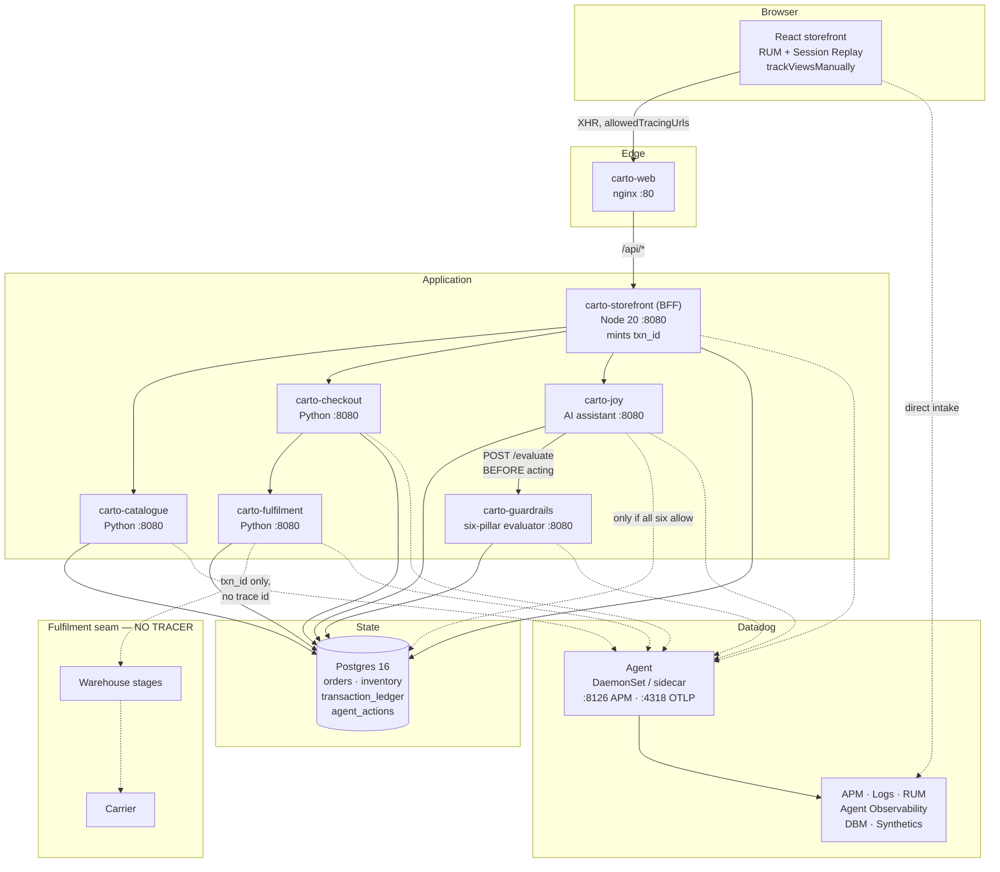

# Carto — a Datadog demo harness you can actually deploy

A working online retailer, instrumented end to end, built to tell one story in front of one room:
**a new range goes live, a customer finds it, adds to the bag and checks out on a peak trading
day** — and every rung of the observability maturity ladder is climbed against that single journey.
On top of that sits a second story: **an AI assistant that is allowed to act on a customer's order,
and the six guardrails that decide whether it may.**

> **Carto is fictional.** The brand, wordmark, palette, product range and shoppers were invented for
> this harness. No real customer, order or company data appears anywhere in this repository.

Two things make it more than a toy:

1. **Business tracking ids that survive where tracing stops.** Datadog stamps every request with a
   trace id, and inside the instrumented estate that is the best identifier there is. It stops being
   enough at the **fulfilment seam** — the warehouse and the carrier run no tracer, and a customer on
   the phone quotes an order number, never a trace id. So every transaction also carries a
   `txn_id`, an `order_id` and a `customer_id`, minted by the application and propagated by header,
   and the harness proves the point by showing **7 traced hops and 3 black-box hops on the same
   timeline**.
2. **An AI write path with real governance.** The assistant can refund, cancel and re-address
   orders — but only after an evaluator it does not control approves on all six pillars, and only
   with an audit trail it cannot edit.

Everything below works from a clean clone. The harness runs three ways: **Compose** (Podman or
Docker), **local Kubernetes** (kind), and **GKE**.

---

## Contents

- [Architecture](#architecture)
- [Prerequisites](#prerequisites)
- [Credentials: the one file you edit](#credentials-the-one-file-you-edit)
- [Quick start 1: Compose on Podman or Docker](#quick-start-1-compose-on-podman-or-docker)
- [Quick start 2: local Kubernetes on kind](#quick-start-2-local-kubernetes-on-kind)
- [Quick start 3: Google Kubernetes Engine](#quick-start-3-google-kubernetes-engine)
- [Quick start 4: single-node GKE (cheapest)](#quick-start-4-single-node-gke-cheapest)
- [Kubernetes layout](#kubernetes-layout)
- [Credentials in Kubernetes](#credentials-in-kubernetes)
- [What is running](#what-is-running)
- [AI guardrails: the six pillars](#ai-guardrails-the-six-pillars)
- [Real User Monitoring (RUM)](#real-user-monitoring-rum)
- [The two ID systems](#the-two-id-systems)
- [Demo scenarios](#demo-scenarios)
- [Datadog assets](#datadog-assets)
- [Troubleshooting](#troubleshooting)
- [What this costs on GKE](#what-this-costs-on-gke)
- [Teardown](#teardown)

---

## Architecture



Solid arrows are the request path. Dotted arrows into the Agent are telemetry. The dotted arrows
out of `carto-fulfilment` are the point of the whole harness: **those hops carry a `txn_id` and no
trace id**, because the systems on the other side run no tracer.

The app also serves two richer diagrams once it is running:

| Page | What it covers |
|---|---|
| `/architecture.html` | Every service, signal routing per mode, the Joy integration depth, and the six pillars |
| `/demo-walkthrough.html` | The run sheet, with the current failure state of each scenario |

---

## Prerequisites

| Target | You need |
|---|---|
| **Compose** | Podman 5+ *or* Docker 24+, plus `docker-compose` v2/v5. ~4 GB RAM free. |
| **kind** | The above, plus `kind` and `kubectl`. **~8 GB RAM free.** |
| **GKE** | `gcloud`, `kubectl`, a GCP project with billing. |
| **All** | A Datadog account (a trial is fine) and an Anthropic API key. |

On **Apple Silicon with Podman**, the machine defaults to about 4 GB, which is not enough for
Kubernetes. Give it room once:

```bash
podman machine stop && podman machine set --cpus 8 --memory 12288 && podman machine start
```

Podman Desktop installs to `/opt/podman/bin` and does **not** add itself to your shell profile. The
`./carto` wrapper detects Podman and fixes its own `PATH`, so you do not have to.

---

## Credentials: the one file you edit

Everything lives in **`carto.env`**. Nothing else in the repository hardcodes a key, a project, a
region or an org.

```bash
cp carto.env.example carto.env
$EDITOR carto.env
```

`carto.env` is gitignored. `carto.env.example` is tracked and contains no secrets.

### The three values you must set

Everything else has a working default. Open `carto.env` and fill in these three — the file is
organised into numbered sections and each one sits under its own heading:

```bash
# --- section 1. DATADOG ---
DD_API_KEY=<40-hex-char key>          # Organization Settings -> API Keys -> New Key
DD_SITE=datadoghq.com                 # the host you log in to; see the warning below

# --- section 2. ANTHROPIC ---
ANTHROPIC_API_KEY=sk-ant-...          # console.anthropic.com -> API Keys
```

Two more are needed the moment you push Datadog assets or deploy to GKE:

```bash
# --- section 1. DATADOG ---
DD_APP_KEY=<40-hex-char key>          # Personal Settings -> Application Keys
ALERT_EMAIL=you@example.com           # where the presenter alert is sent

# --- section 4. CLOUD (GKE only) ---
GCP_PROJECT_ID=my-project
GCP_REGION=australia-southeast1
GKE_CLUSTER_NAME=carto-demo
```

Then check your work before starting anything:

```bash
./carto doctor --creds-only
```

That calls Datadog's `/api/v1/validate` and Anthropic's `/v1/models` with your keys, so a wrong
key or a wrong site is caught in two seconds rather than becoming silence in a dashboard an hour
later. It stops after the credentials section and tells you the next command.

Run the **full** `./carto doctor` only once something is up — its other seven sections check
containers, endpoints and signals, so against a stopped stack it reports a wall of failures that
say nothing about your setup.

### What goes where

| Section | Variables | Where to get them | Needed for |
|---|---|---|---|
| **1 Datadog** | `DD_API_KEY` | Organization Settings → API Keys | Always |
| | `DD_APP_KEY` | Personal Settings → Application Keys | Creating dashboards/monitors |
| | `DD_SITE` | The host you log in to | Always |
| | `ALERT_EMAIL` | Your own address or `@slack-channel` | The presenter alert |
| **2 Anthropic** | `ANTHROPIC_API_KEY` | console.anthropic.com → API Keys | The AI assistant |
| **3 RUM** | `DD_RUM_APPLICATION_ID` etc. | Auto-created by `./carto rum` | Optional |
| **4 Cloud** | `GCP_PROJECT_ID`, `GCP_REGION`, `GKE_CLUSTER_NAME`, `IMAGE_REGISTRY` | Your GCP project | GKE only |
| | `AWS_*`, `AZURE_*` | Your cloud accounts | Only if you point the demo at EKS/AKS |
| **5 Tagging** | `DD_ENV`, `DD_TEAM`, `HARNESS_OWNER` | Yours to choose | Always |
| **6 Tuning** | Load rates, guardrail thresholds | Sensible defaults | Always |
| | `GUARDRAIL_AGENT_TOKEN` | Yours to choose | The identity pillar — **see below** |
| **7 Passwords** | `POSTGRES_PASSWORD`, `CARTO_DEMO_PASSWORD` | Yours to choose | Defaults work; change for anything shared |
| | `DD_GIT_REPOSITORY_URL`, `DD_GIT_COMMIT_SHA` | Your fork | Source Code Integration (optional) |
| **Other** | `WEB_URL` | The address you browse to | Datadog deep links — `:5175` Compose, `:8080` kind, the LB IP on GKE |
| | `CONTAINER_CLI` | `docker` or `podman` | GKE builds on Podman |

> **`GUARDRAIL_AGENT_TOKEN` has a public default.** It is the shared secret the agent presents to
> prove its identity, and pillar 1 rejects any action whose token does not match. The default
> (`carto-agent-attestation`) ships in this repo so the demo runs immediately — which means anyone
> reading this knows it. Set your own before presenting identity as a real control.

> **`DD_SITE` is the single most common setup mistake.** Set it wrong and data is accepted but
> lands in an org you cannot see. `datadoghq.com` is US1; `datadoghq.eu` is EU1;
> `ap1.datadoghq.com` is AP1. Check the URL in your browser.

### Cloud authentication

The GKE script never reads a service-account key from `carto.env`. Authenticate the normal way
instead, and it picks the credentials up:

```bash
gcloud auth login && gcloud auth application-default login     # a human
export GOOGLE_APPLICATION_CREDENTIALS=/path/to/key.json        # a CI job
```

The `AWS_*` and `AZURE_*` blocks exist only for pointing the demo at a cluster or integration in
those clouds. Prefer a role (`AWS_ROLE_ARN`) over static keys, and never commit either.

---

## Quick start 1: Compose on Podman or Docker

```bash
cp carto.env.example carto.env     # then fill in DD_API_KEY, DD_SITE, ANTHROPIC_API_KEY
./carto doctor --creds-only        # 1. check the keys before an eight-image build
./carto up                        # 2. build and start everything
./carto rum                       # 3. mint the RUM app, rebuild the bundle
./carto assets                    # 4. push dashboards, monitors, SLOs, synthetics
./carto doctor                    # 5. full check: containers, endpoints, signals, ids
```

Compose publishes every service on its own host port:

| Surface | URL (Compose) |
|---|---|
| Storefront | http://localhost:5175 |
| Demo run sheet | http://localhost:5175/demo-walkthrough.html |
| Architecture | http://localhost:5175/architecture.html |
| AI guardrails | http://localhost:5175/guardrails |
| Transaction tracking | http://localhost:5175/track |
| BFF | http://localhost:8091 |
| Guardrail evaluator | http://localhost:8025 |

**On Kubernetes the storefront is on `:8080`, not `:5175`** — see Quick start 2. Set `WEB_URL`
in `carto.env` to whichever applies, because the Datadog monitors and dashboards deep-link
back into the app and take the URL from there.

Day-to-day:

```bash
./carto stop      # graceful, dependency-ordered; containers kept
./carto start     # bring them back
./carto status    # containers + endpoint probes
./carto logs
```

---

## Quick start 2: local Kubernetes on kind

The manifests are written for GKE. `kind` runs a real API server and kubelet, so a green run here
means something; `podman kube play` would ignore Deployments, Ingress and probes and tell you
nothing.

```bash
./carto doctor --creds-only       # 1. check the keys first
./carto rum                       # 2. BEFORE the build — see below
./scripts/kind-up.sh              # 3. cluster, ingress-nginx, images, manifests, secrets
```

> **Run `./carto rum` before `kind-up.sh`, not after.** The storefront inlines its RUM
> `applicationId` and `clientToken` at *build* time, and `kind-up.sh` is what builds the image.
> Provision afterwards and you get a cluster whose storefront has RUM switched off, with nothing
> to tell you — the SPA simply does not call `datadogRum.init()` when the app id is empty. If you
> have already built, re-run `./carto rum` then `./scripts/kind-up.sh --rebuild`.

That script creates the cluster, installs ingress-nginx, **builds and side-loads the eight images**
(kind cannot pull `carto-*` from anywhere), applies `k8s/overlays/kind`, and creates the Secret
from your `carto.env`. The storefront lands on **http://localhost:8080**.

Only the storefront is exposed; every service listens on `:8080` inside the cluster.

| Surface | URL (kind) |
|---|---|
| Storefront | http://localhost:8080 |
| Demo run sheet | http://localhost:8080/demo-walkthrough.html |
| Architecture | http://localhost:8080/architecture.html |
| AI guardrails | http://localhost:8080/guardrails |
| Transaction tracking | http://localhost:8080/track |
| BFF, guardrail evaluator | `kubectl -n carto port-forward svc/bff 8091:8080` (likewise `svc/guardrails`) |

Set `WEB_URL=http://localhost:8080` in `carto.env` before `./carto assets` so the monitors
and dashboards link back to this cluster rather than to a Compose stack.

```bash
kubectl -n carto get pods
kubectl -n carto logs -l app=guardrails -f
./scripts/kind-up.sh --rebuild    # after changing application code
```

Expect the image side-load to be the slow part — eight images through a tar pipe.

---

## Quick start 3: Google Kubernetes Engine

```bash
# fill in GCP_PROJECT_ID, GCP_REGION, GKE_CLUSTER_NAME in carto.env first
./carto doctor --creds-only         # 1. check the keys
gcloud auth login                   # 2. GCP credentials come from gcloud, not carto.env
./carto rum                         # 3. BEFORE the build — see below
./scripts/gke-deploy.sh --dry-run   # 4. print the manifests, change nothing
./scripts/gke-deploy.sh             # 5. create cluster, build, push, deploy
```

> **`./carto rum` goes before the deploy, for the same reason as on kind** — the RUM app id is a
> *build* arg, and `gke-deploy.sh` builds the images. The script tells you which way it went:
> `✓ RUM app id found` or `! the storefront will build WITHOUT RUM`.

The script enables the required APIs, creates the cluster if it is absent, creates an Artifact
Registry repository, **builds `linux/amd64` images**, pushes them, applies `k8s/overlays/gke`, and
creates the Secret from `carto.env`. It deletes nothing.

Two things worth knowing before you run it:

- **Build architecture.** GKE nodes are amd64. Building on an Apple Silicon laptop without
  `--platform linux/amd64` produces arm64 images that `CrashLoopBackOff` with `exec format error`.
  The script always passes the flag; if you build by hand, you must too.
- **Autopilot will not work as written.** The Datadog Agent DaemonSet needs `hostPID` and host
  path mounts that Autopilot blocks. Use `GKE_MODE=standard`, or switch to the Datadog Operator or
  Helm chart, which have an Autopilot-compatible mode. The script warns you rather than failing
  thirty minutes in.
- **On Podman, set `CONTAINER_CLI=podman`** in `carto.env`, or put `scripts/podman-shim` on your
  PATH. The script builds with `docker` by default and otherwise stops at `docker: command not
  found`.
- **`GKE_NODE_COUNT` is per zone.** The script creates a *regional* cluster, and a region has
  three zones, so the total is `GKE_NODE_COUNT × 3`. gcloud's own default of 3 would build **nine**
  nodes. This repo ships `GKE_NODE_COUNT=1` — three nodes, one per zone.
- **It bills while it exists, not while you demo.** See
  [What this costs on GKE](#what-this-costs-on-gke) before you leave one running.

Find the storefront once the load balancer has an address:

```bash
kubectl -n carto get ingress carto -w
```

Then point the Datadog assets at it. The deep links in the monitors and dashboards come from
`WEB_URL`, and on GKE that address does not exist until the load balancer is up, so it cannot
be set beforehand — `gke-deploy.sh` prints this reminder with the real IP filled in:

```bash
WEB_URL=http://<load-balancer-ip> ./carto assets
```

## Quick start 4: single-node GKE (cheapest)

A real GKE cluster with exactly one node. Roughly **a third the cost of the regional default** —
about US$8 a day instead of US$18 — and the only shape that fits inside Google's US$74.40/month
cluster-fee credit.

```bash
# in carto.env, alongside the section 4 values:
#   GKE_TOPOLOGY=zonal
#   GCP_ZONE=australia-southeast1-a      # must be a zone, not a region
#   GKE_NODE_COUNT=1

./carto doctor --creds-only         # check the keys
./carto rum                         # before the build, as in Quick start 3
./scripts/gke-deploy.sh --dry-run   # confirm it says topology=zonal overlay=gke-single
./scripts/gke-deploy.sh
```

The script prints what it is about to build before it builds it:

```
→ project=my-project zone=australia-southeast1-a cluster=carto-demo
→ topology=zonal overlay=gke-single nodes=1 x e2-standard-4
```

**Why a separate topology rather than just `GKE_NODE_COUNT=1`.** A regional cluster takes
`--num-nodes` *per zone* and a region has three, so the smallest regional cluster is three nodes.
Only a zonal cluster (`--zone`) takes the number literally. Setting `GKE_TOPOLOGY=zonal` switches
the `gcloud` flag *and* selects `k8s/overlays/gke-single`, which collapses every Deployment to one
replica — two replicas pinned to the same node survive no failure a single replica would not.

It inherits everything from the `gke` overlay: the `gce` ingress class, the BackendConfig health
check, `DD_ENV=prd` and kubelet TLS verification. Only the replica counts change.

| | Regional (default) | Single-node |
|---|---|---|
| Nodes | 3 (1 per zone) | 1 |
| Pods | 15 | 10 |
| CPU requested | 1470m | **1060m** |
| Memory requested | 3.3 GiB | **2.4 GiB** |
| Datadog billed hosts | 3 | **1** |
| Survives a zone failure | yes | **no** |
| Cost (Sydney, on demand) | ~$18/day | **~$8/day** |

That fits one `e2-standard-4` (4 vCPU / 16 GB, ~3.9 vCPU allocatable) with room for GKE's own
system pods.

**Do not shrink the machine type further.** An `e2-standard-2` leaves ~2 vCPU for ~1.06 vCPU of
application requests plus ~0.6 vCPU of GKE system pods — it schedules with almost no headroom, and
the Puppeteer load driver is bursty. If you need it cheaper, use Spot nodes (~$0.085/hr in Sydney
against ~$0.190 on demand) or turn the driver down with `LOAD_CONCURRENCY=1`.

**What you give up:** zone redundancy, and rolling updates that stay fully available — with one
replica, a rollout has a brief gap while the new pod becomes ready. Fine for a demo, not a pattern
to copy into production.

Tear it down with the **`--zone`** flag, not `--region`:

```bash
gcloud container clusters delete "$GKE_CLUSTER_NAME" --zone "$GCP_ZONE"
```

---

## Kubernetes layout

```
k8s/
├── base/                      portable across clusters
│   ├── 00-namespace.yaml
│   ├── 01-config.yaml         non-secret config
│   ├── 02-secret.yaml         PLACEHOLDER ONLY, all values empty
│   ├── 11-postgres-init.yaml  GENERATED from postgres/*.sql
│   ├── 10-postgres.yaml       StatefulSet + PVC
│   ├── 20-services.yaml       GENERATED, the six app services
│   ├── 30-web.yaml            storefront, load driver, Ingress
│   ├── 40-datadog-agent.yaml  DaemonSet + RBAC
│   └── kustomization.yaml
└── overlays/
    ├── kind/                  1 replica, nginx ingress, imagePullPolicy Never
    ├── gke/                   GCE ingress, BackendConfig, kubelet TLS on
    └── gke-single/            inherits gke; every Deployment to 1 replica
```

`20-services.yaml` and `11-postgres-init.yaml` are generated by `scripts/gen-k8s.py`. Edit the
generator or the SQL, re-run it, and commit the result — `postgres/*.sql` stays the single source
of truth for the schema, shared with Compose.

---

## Credentials in Kubernetes

`k8s/base/02-secret.yaml` is tracked and **every value in it is empty**. It exists to document the
shape. Real values arrive one of three ways:

**1. From `carto.env` (what both deploy scripts do).** No key ever touches disk inside the repo:

```bash
kubectl -n carto create secret generic carto-secrets \
  --from-literal=DD_API_KEY="$DD_API_KEY" \
  --from-literal=DD_APP_KEY="$DD_APP_KEY" \
  --from-literal=ANTHROPIC_API_KEY="$ANTHROPIC_API_KEY" \
  --from-literal=POSTGRES_PASSWORD="$POSTGRES_PASSWORD" \
  --from-literal=GUARDRAIL_AGENT_TOKEN="$GUARDRAIL_AGENT_TOKEN" \
  --dry-run=client -o yaml | kubectl apply -f -
```

**2. Google Secret Manager**, for anything long-lived. Store the keys there, give the node pool's
service account `roles/secretmanager.secretAccessor`, and mount them with the
[Secrets Store CSI driver](https://cloud.google.com/secret-manager/docs/secret-manager-managed-csi-component).
Nothing in the manifests assumes the Secret was created by `kubectl`.

**3. External Secrets Operator**, if you already run it.

`DD_SITE` is deliberately **not** a secret. It lives in `carto-config`, because it is not sensitive
and putting it in the Secret makes it harder to see when it is wrong.

---

## What is running

Ports below are the host ports **Compose** publishes. Under Kubernetes every service
listens on `:8080` in-cluster and only the storefront is reachable, via the ingress.

| Service | Runtime | Port (Compose) | Responsibility |
|---|---|---|---|
| `carto-web` | nginx + React | 5175 → 80 | Storefront, RUM, Session Replay |
| `carto-storefront` | Node 20 + Express | 8091 | BFF: sessions, bag, checkout orchestration, `/api/track`, demo control plane. **Mints `txn_id`** |
| `carto-catalogue` | Python 3.12 | 8021 | Range, search, inventory reservation, new-range contract |
| `carto-checkout` | Python 3.12 | 8022 | Payment authorisation, order creation |
| `carto-fulfilment` | Python 3.12 | 8023 | Traced dispatch **plus the black-box stage worker** |
| `carto-joy` | Python 3.12 + Anthropic | 8024 | Grounded assistant; Agent Observability; the governed write path |
| `carto-guardrails` | Python 3.12 | 8025 | **Six-pillar evaluator.** Fails closed |
| `carto-load` | Node + Puppeteer | — | 3 headless shoppers, a journey every ~16s |
| `carto-postgres` | Postgres 16 | 5432 | State + `transaction_ledger` + the agent audit tables |
| `datadog-agent` | Agent 7 | 8126 / 4318 | APM, logs, process, DBM, OTLP metrics |

### Demo shoppers

| Login | Customer id | Notes |
|---|---|---|
| `bob` | `CT-CUST-1001` | Pinned into `express_checkout_v2` — checkouts over $100 hit the regressed path |
| `alice` | `CT-CUST-1002` | Clean path |
| `carol` | `CT-CUST-1003` | Clean path |
| `dan` | `CT-CUST-1004` | Clean path |
| **`raj`** | **`CT-CUST-9001`** | **The presenter's own account** |

Password for all of them is `carto`.

**Raj is excluded from the load driver and the synthetics on purpose.** `SHOPPERS` in
`load/main.js` does not contain him, and the order-journey synthetic signs in as `alice`. That is
what makes `@usr.id:CT-CUST-9001` return exactly one session — yours — so a failure you trigger on
stage is attributable to a human and not to background traffic. A monitor on that customer id
emails `ALERT_EMAIL` within about 30 seconds.

---

## AI guardrails: the six pillars

The assistant started read-only: a bad answer only misleads. The moment it is allowed to **act** —
refund an order, change an address, cancel a shipment — the question stops being "was the answer
good" and becomes "was the action allowed, and can you prove it afterwards".

Every attempted action is evaluated by `carto-guardrails` before it runs. The evaluator is a
separate service **because an agent that grades its own homework is not governed**.

| # | Pillar | The question | How it is decided here |
|---|---|---|---|
| 1 | **Identity** | Who is acting, and can it be proven? | A platform-issued attestation token, plus an authenticated human principal for anything touching an order. The BFF asserts authentication from the session — never the browser. |
| 2 | **Authority** | May this agent do *this*, at *this* value? | Per-action grants in `agent_scopes` with optional ceilings. Joy may refund to A$300 and may **never** override a price — seeded as explicitly revoked, so the pillar reports "revoked", not "unknown". |
| 3 | **Condition** | Are the preconditions true right now? | The order exists, is in a valid state, and **belongs to the acting principal** — the confused-deputy check. |
| 4 | **Human approval** | Should a person decide? | Over `GUARDRAIL_APPROVAL_THRESHOLD_AUD` the action parks and returns *pending*, which is not an allow. **An approval nobody answers expires, and expiry denies.** |
| 5 | **Budget** | Can this session afford it? | Every model call reports its real cost to `/spend`, priced per million tokens. The ceiling is enforced against actual usage. |
| 6 | **Evidence** | Can this be reconstructed later? | The pillar chain is hashed and persisted, and the action must carry a `txn_id` or `order_id`. Runs **even when an earlier pillar denied**, because a refusal must be auditable too. |

Pillars run in order and **fail closed**: an exception inside a pillar is a deny, and if the
evaluator is unreachable the agent refuses to act rather than proceeding optimistically.

Try it at **`/guardrails`**, where six scenarios are each refused by a different pillar:

| Scenario | Refused by |
|---|---|
| Refund A$40 on a delivered order | nothing — all six allow |
| Refund A$220 | **Human approval** parks it as pending |
| Refund A$400 (ceiling A$300) | **Authority** |
| Override a price | **Authority** — grant revoked |
| Cancel an already-delivered order | **Condition** |
| Refund with no order id | **Condition**, and **Evidence** would too |

> **The thresholds have to be ordered sensibly or a pillar becomes unreachable.** If the refund
> ceiling sat *below* the approval threshold, Authority would refuse every refund big enough to
> need a human, and pillar 4 could never fire. The seed comments say so; keep the three bands in
> that order if you change them.

### Seeing all six pillars in one waterfall

Each pillar emits its own span (`guardrail.identity`, `guardrail.authority`, …) as a child of the
evaluation. A **denied** pillar also sets `span.error = 1` with `error.type: GuardrailDenied`, which
is deliberate: it puts the refusal into Error Tracking and onto the service's error rate instead of
being a 200 nobody looks at.

A side effect is that with **default APM retention**, the denial span is indexed and its five
`allow` siblings are not — so a span search shows `guardrail.authority` alone rather than the full
six-span waterfall. That is retention, not instrumentation. To keep the whole chain, add a retention
filter:

> APM → Retention Filters → New, on `service:carto-guardrails`, 100% sample.

Traces are always ingested in full; the filter governs what stays searchable.

Turning guardrails off (`GUARDRAIL_ENABLED=false`) lets you show the same action succeeding
unguarded. Doing so logs `guardrail_decision:bypassed` and alerts at P1, because guardrails being
off is itself an audit finding.

---

## Real User Monitoring (RUM)

RUM is the browser half of this demo. Without it the story stops at the server: you can see that a
checkout failed, but not the click that caused it, not what the shopper saw, and not which session
belongs to the order number on a support call.

### What it is wired to do here

| Capability | Where | Why it matters in the demo |
|---|---|---|
| Session Replay, 100% sampled | `sessionReplaySampleRate: 100` | "Show me what the customer saw" |
| `usr.id` = Carto customer id | `rumSetCustomer()` | `@usr.id:CT-CUST-1001` finds the shopper's sessions **and** their APM spans — the BFF stamps the same value |
| `txn_id` / `order_id` as global context | `rumSetTxn()` | A support call that starts with an order number ends at a session replay |
| RUM → APM trace join | `allowedTracingUrls` on `/api/` | A click and its backend trace are one object |
| Manual views | `trackViewsManually: true` | **Mandatory** — `App.jsx` calls `startView()` itself; leaving the default double-counts every navigation |
| Feature-flag evaluations | `rumFlags()` | Shows which cohort a session was in when it broke |
| One session per window | `stopSession()` on `pagehide` | Walking the same journey three times gives three sessions, not one |

Privacy is `defaultPrivacyLevel: 'mask-user-input'`, so typed input is masked in replays.

### The one thing to understand

**The RUM `applicationId` and `clientToken` are compiled into the JavaScript bundle at build
time.** Vite inlines `VITE_DD_RUM_*` when the SPA is built; there is no runtime setting, no
environment variable on the running container, and no ConfigMap that can switch RUM on afterwards.

Everything below follows from that. The SPA checks:

```js
export const RUM_ENABLED = Boolean(env.VITE_DD_RUM_APPLICATION_ID && env.VITE_DD_RUM_CLIENT_TOKEN);
```

If the app id was empty at build time, `initRum()` returns immediately. **There is no error.** RUM
is simply absent — which is exactly how it can look fine and send nothing.

### Steps

**1. Mint the RUM application.** Needs `DD_API_KEY` and `DD_APP_KEY` in `carto.env`.

```bash
./carto rum
```

It looks for a RUM application named `carto-web` on your `DD_SITE` and **reuses it if it exists**,
so it is safe to re-run. It writes `docker-compose.override.yaml`:

```yaml
services:
  web:
    build:
      args:
        VITE_DD_RUM_APPLICATION_ID: "…"
        VITE_DD_RUM_CLIENT_TOKEN: "…"
```

That file is gitignored — the ids are yours, not the repo's.

**2. Build the storefront *after* step 1**, because the build is what inlines the values.

| Path | Command | Note |
|---|---|---|
| Compose | `./carto up` | `./carto rum` rebuilds and recreates `web` itself, so either order works |
| kind | `./scripts/kind-up.sh` | Must come **after** `./carto rum`. Already built? `./scripts/kind-up.sh --rebuild` |
| GKE | `./scripts/gke-deploy.sh` | Must come **after**. It prints `✓ RUM app id found` or `! …WITHOUT RUM` before building |

**3. Verify it is actually in the bundle** — the only check that proves anything:

```bash
# replace the origin with your own: :5175 Compose, :8080 kind, the LB IP on GKE
B=$(curl -s http://localhost:8080/ | grep -oE '/assets/index-[A-Za-z0-9_-]+\.js' | head -1)
curl -s "http://localhost:8080$B" | grep -c "$(grep -oE '[0-9a-f]{8}-[0-9a-f]{4}-[0-9a-f]{4}-[0-9a-f]{4}-[0-9a-f]{12}' docker-compose.override.yaml | head -1)"
```

`1` means the id is compiled in. `0` means it is not, whatever the deploy said.

**4. Confirm events arrive.** Load the storefront in a browser, click through a journey, then look
in Datadog under **RUM → Sessions** for `service:carto-web`. From the terminal:

```bash
./scripts/creds-from-env.sh python3 - <<'EOF'
import os, json, urllib.request
req = urllib.request.Request(
    "https://api.%s/api/v2/rum/events/search" % os.environ["DD_SITE"],
    data=json.dumps({"filter": {"from": "now-15m", "to": "now",
                                "query": "@service:carto-web"}}).encode(),
    headers={"DD-API-KEY": os.environ["DD_API_KEY"],
             "DD-APPLICATION-KEY": os.environ["DD_APP_KEY"],
             "Content-Type": "application/json"})
print(len(json.load(urllib.request.urlopen(req)).get("data", [])), "RUM events")
EOF
```

### If the bundle is right but Datadog is empty

Some corporate resolvers — DNSFilter among them — return NODATA for
`browser-intake-datadoghq.com` while leaving `api.datadoghq.com` alone. The Agent then ships
traces, logs and metrics perfectly and **the browser SDK goes completely dark with no error**,
because it cannot resolve its own intake host.

```bash
getent hosts browser-intake-datadoghq.com      # NODATA / nothing = this is your problem
```

On **Compose** there is a workaround:

```bash
make rum-unblock      # resolves the intake over DNS-over-HTTPS, pins the addresses,
                      # and switches the SDK to same-origin delivery via /dd-rum
./carto up            # rebuild so VITE_DD_RUM_PROXY is inlined
```

It writes `docker-compose.rum-dns.yaml` with `extra_hosts` for the containers, plus an nginx
snippet under `web/rum-proxy/` so a human browsing from the host is covered too. The addresses
rotate — re-run it if RUM goes quiet.

**There is no Kubernetes equivalent.** On such a network, RUM will not reach Datadog from kind or
GKE. The real fix is a DNS allowlist entry for `*.browser-intake-<your DD_SITE>`; the proxy exists
only because that is not always available quickly.

---

## The two ID systems

| | Datadog trace id | Carto business ids |
|---|---|---|
| Minted by | the tracer | the application |
| Shape | 128-bit hex | `CRTX-…`, `CRT-…`, `CT-CUST-…`, `CRTA-…` |
| Survives the fulfilment seam | **no** | **yes** |
| A customer can quote it | no | yes |
| Queryable in Datadog | natively | as `@txn_id`, `@order_id`, `@customer_id` |

```
hop  name                        system     trace id
0    browser_checkout_submitted  traced     549882316295808595
1    checkout_received           traced     549882316295808595
3    inventory_reserved          traced     549882316295808595
5    order_confirmed             traced     549882316295808595
6    handoff_to_wms              blackbox   —
7    picked                      blackbox   —
8    carrier_collected           blackbox   —
```

Look any transaction up by **either** id at `/track`, or with `./carto track CRTX-…`.

---

## Demo scenarios

```bash
./carto break new-range      # new range published but invisible on the storefront
./carto break payment        # card auth fails for one fulfilment method
./carto break peak           # latency and error rate climb
./carto break stall          # orders stop past the fulfilment seam
./carto break raj            # checkout fails for Raj Patel only → emails ALERT_EMAIL
./carto fix <scenario>       # clear it
./carto state                # what is armed right now
```

The armed state is visible in three places without leaving the storefront: a strip at the top of
every page, the full `/demo-state` view, and the run sheet. All three read one endpoint,
`/api/demo/status`, which predicts **whether the order you are about to place will fail, and why**.

---

## Datadog assets

```bash
./carto assets      # push everything
```

| Kind | Files |
|---|---|
| Dashboards | Executive overview · Order journey + tracking · **AI guardrails** |
| Monitors | Checkout failure rate · p95 latency · payment gateway · orders stalled · tracking lookups · new-range content · prompt injection · **Raj Patel transactions** · **guardrail denials** · **evidence gaps** · **guardrails bypassed** · **approvals expiring** |
| SLOs | Checkout success · order journey completion · new-range availability |
| Synthetics | Storefront availability · order journey (multistep, with id assertions) · new-range content correctness |
| Software Catalog | `catalog/carto-entities.yaml` |

Asset definitions are tracked in git, so they carry `${ALERT_EMAIL}` rather than anyone's address.
`scripts/dd-push.py` expands those from your environment at push time and warns about any variable
it could not resolve.

---

## Troubleshooting

**Nothing appears in Datadog.** Check `DD_SITE` first. Then `./carto doctor`, which checks
32 things including whether metrics, logs and traces are actually arriving.

**Products do not load.** `curl localhost:8091/healthz` — it deliberately touches Postgres, so a
healthy response proves the database path, not just that the process is listening. Then
`./carto logs bff`.

**`carto-guardrails` returns 500 and `/policy` is empty.** Its tables are missing. The seed runs
**only against an empty data directory**, so adding the guardrails schema to an existing database
needs the volume recreated:

```bash
./carto down && podman volume rm carto_postgres-data && ./carto up
```

On Kubernetes: `kubectl -n carto delete sts postgres && kubectl -n carto delete pvc -l app=postgres`.
Since the evaluator's `/healthz` verifies its own tables, a missing migration shows up as an
unready pod rather than as 500s in production.

**Traces, logs and metrics arrive but RUM is empty.** Two different causes, in this order.
First, check the storefront was built *with* an app id: `curl -s <storefront>/ | grep -o
'/assets/index-[^"]*'` then grep that bundle for your RUM application id. If it is absent, RUM was
never compiled in — run `./carto rum`, then rebuild (`./scripts/kind-up.sh --rebuild`, or re-run
`gke-deploy.sh`). Second, if the id *is* in the bundle, check DNS: some corporate resolvers
(DNSFilter among them) return NODATA for `browser-intake-datadoghq.com` while leaving
`api.datadoghq.com` alone, so the Agent ships everything perfectly and the browser SDK goes dark
with no error. Test it with `getent hosts browser-intake-datadoghq.com`. On Compose, `make
rum-unblock` works around it with a same-origin proxy; **there is no Kubernetes equivalent yet**, so
on such a network RUM will not reach Datadog from a cluster.

**Pods stuck in `Init:0/1`.** They are waiting for Postgres, which is correct. Postgres runs three
seed files on first start. `kubectl -n carto logs postgres-0`.

**`exec format error` on GKE.** arm64 images on amd64 nodes. Rebuild with
`--platform linux/amd64`.

**The synthetics worker crash-loops on Apple Silicon.** It is an amd64-only image. Podman registers
`qemu-x86_64` binfmt inside its machine and it works unchanged. Docker Desktop needs
`docker run --privileged --rm tonistiigi/binfmt --install amd64` after every restart.

**The Agent's `orchestrator_kubelet_config` check shows `[ERROR]`.** Expected. The full
orchestrator explorer needs the **Datadog Cluster Agent**, which this manifest deliberately does
not deploy — the DaemonSet alone is kept readable so a reviewer can see every capability as one
line. APM, logs, metrics, process and DBM are unaffected. If you want the orchestrator explorer,
cluster checks and the external metrics provider, install the
[Datadog Operator or Helm chart](https://docs.datadoghq.com/containers/kubernetes/installation/)
alongside and remove `40-datadog-agent.yaml`.

**kind pods are `Pending` or get OOM-killed.** The Podman machine is too small. See
[Prerequisites](#prerequisites).

---

## What this costs on GKE

The stack is small: **990m CPU and 2.3 GiB of memory requested in total**, which fits on a single
`e2-standard-4`. What you pay is mostly a function of how many nodes you let GKE create.

Prices below are `australia-southeast1` (Sydney), on demand, no committed-use or sustained-use
discount, USD. Compute and disk rates come from third-party price trackers, not Google's own page —
**check the [pricing calculator](https://cloud.google.com/products/calculator) for your region
before relying on them.**

| | Nodes | Compute | GKE fee | Disks | LB | **Per hour** | **Per day** | **Per month** |
|---|---|---|---|---|---|---|---|---|
| gcloud default (`--num-nodes 3`, regional) | 9 | $1.712 | $0.10 | $0.154 | $0.025 | **$1.99** | **$48** | **$1,453** |
| This repo's default (`GKE_NODE_COUNT=1`, regional) | 3 | $0.571 | $0.10 | $0.051 | $0.025 | **$0.75** | **$18** | **$545** |
| [Single-node](#quick-start-4-single-node-gke-cheapest) (`GKE_TOPOLOGY=zonal`) | 1 | $0.190 | $0.10 | $0.017 | $0.025 | **$0.33** | **$8** | **$241** |

Components, so you can re-derive these for your own region:

- **Compute** — `e2-standard-4` (4 vCPU, 16 GB) at **~$0.190/hr** in Sydney, ~$0.134/hr in
  `us-central1`. Spot is ~$0.085–0.10/hr in Sydney and fine for a demo that can tolerate eviction.
- **GKE management fee** — **$0.10 per cluster per hour**, flat, regardless of node count. Google
  gives one Cloud Billing account a **$74.40/month credit**, which covers the fee for a single
  *zonal* cluster; regional clusters do not consume it.
- **Boot disks** — GKE attaches 100 GB `pd-balanced` per node by default, ~**$0.135/GB-month** in
  Sydney, so ~$13.50 per node per month.
- **Load balancer** — the GCE ingress creates a forwarding rule, ~$0.025/hr plus ~$0.01/GB of
  processed traffic.
- **Egress to Datadog** — small for this stack's volume, but not zero.

Two costs that are not on your GCP bill:

- **Datadog Infrastructure bills per host, and the Agent is a DaemonSet** — one Agent per node. Nine
  nodes is nine billed hosts; three is three. This is usually the bigger surprise.
- **Anthropic API** — Joy calls a real model. The defaults are deliberately cheap (Haiku, 180
  max_tokens, a 25s driver interval ≈ 144 calls/hour); set `JOY_DRIVER_ENABLED=false` to stop the
  background driver and leave only the in-app chat.

Cheapest way to run it: [single-node GKE](#quick-start-4-single-node-gke-cheapest) with
`GKE_TOPOLOGY=zonal`, optionally on Spot nodes and with the load driver turned down. Most
realistic for a demo that should survive a zone failure: the regional default of three nodes.

---

## Teardown

```bash
./carto down                                   # Compose: containers and volumes
kind delete cluster --name carto               # local Kubernetes
kubectl delete namespace carto                 # GKE workloads only

# the flag must match the topology you created, or gcloud will not find it
gcloud container clusters delete "$GKE_CLUSTER_NAME" --region "$GCP_REGION"   # regional
gcloud container clusters delete "$GKE_CLUSTER_NAME" --zone   "$GCP_ZONE"     # zonal
```

Datadog assets are not removed by any of the above. Delete them in the UI, or keep them — they cost
nothing when no data is arriving.

---

## Repository layout

```
carto.env.example     every credential and setting, documented      ← start here
carto                 the control surface: up/stop/break/fix/track
compose.yaml          the Compose topology
k8s/                  Kubernetes manifests, base + kind/gke overlays
common/               shared Python: id minting, propagation, ledger
guardrails/           the six-pillar evaluator
joy/                  the AI assistant and its governed write path
bff/ catalogue/ checkout/ fulfilment/   the commerce services
web/                  React storefront, architecture and run-sheet pages
postgres/             schema and seed, shared by Compose and Kubernetes
dashboards/ monitors/ slos/ synthetics/ catalog/   Datadog assets as code
scripts/              deploy, diagnose, validate
```
